<p align="center">
  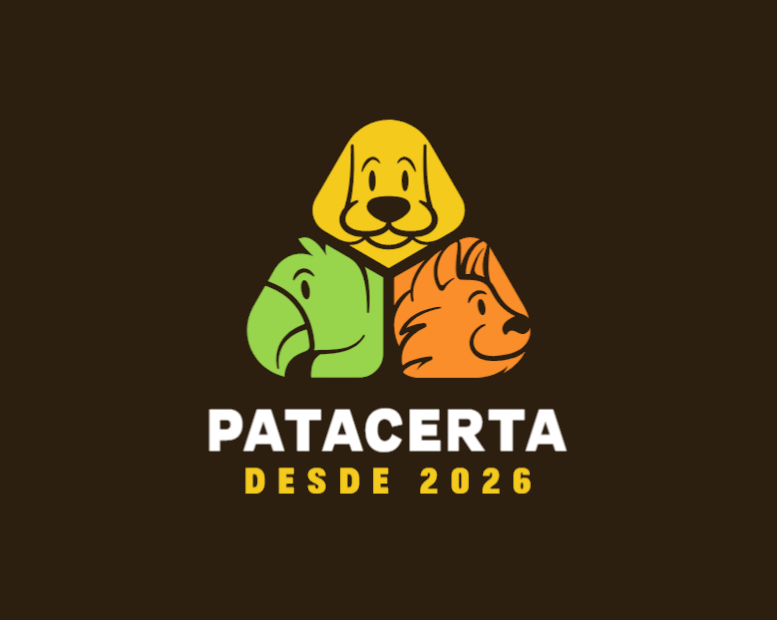
</p>

# PataCerta

Sistema de pet shop e clínica veterinária com uma assistente de IA que responde com base no histórico real de cada pet.

O tutor agenda banho, consulta e vacina pelo app, acompanha o atendimento em tempo real e pergunta à assistente coisas como *"quando foi o último vermífugo do Thor?"*. A equipe da clínica gerencia a agenda num quadro ao vivo, registra o prontuário e gera um resumo pré-atendimento de cada paciente com um clique.

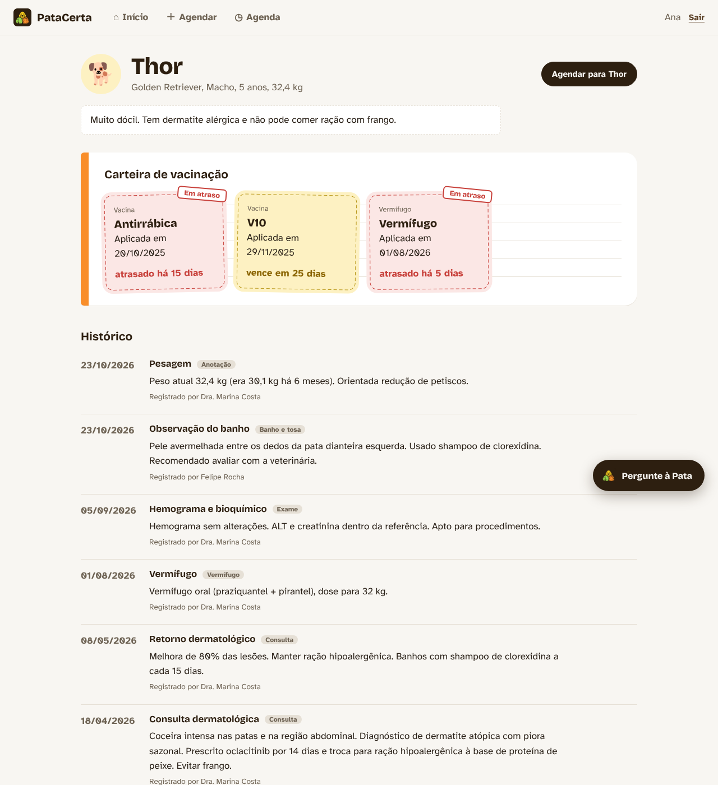

## O que tem de interessante aqui

- **Agentes de IA que agem, não só respondem.** A assistente decide qual ação tomar e executa no sistema, com as permissões de quem está usando:
  - **Agendamento pelo chat (tutor):** "agende um banho para o Thor no sábado de manhã" → consulta o catálogo e a agenda, agenda, remarca ou cancela.
  - **Copiloto da gestão (clínica):** "quanto faturamos este mês?", "qual dia da semana que vem está mais vazio?", "quem não aparece há 90 dias?" → consulta o banco e responde com números exatos.
  - **Retenção proativa (clínica):** o agente acha pets com vacina, vermífugo ou exame atrasado sem nada agendado e clientes que sumiram, escreve uma mensagem personalizada a partir do histórico e sugere aproveitar visitas já marcadas ("o Thor já vem para o banho no sábado: dá para aplicar a vacina na mesma visita"). A equipe revisa e envia.
- **IA contextualizada com os dados do sistema (RAG).** Cada consulta, vacina, banho e agendamento vira um trecho indexado com embeddings numa base vetorial (pgvector). A assistente busca os trechos relevantes, combina com fatos calculados via SQL e responde citando de onde tirou cada informação.
- **Isolamento de dados na busca.** Um tutor nunca recupera registros de outra família, seja qual for a pergunta: o filtro por tutor é aplicado dentro da consulta vetorial e coberto por testes.
- **Embeddings rodando localmente.** O modelo de embeddings (multilíngue, ótimo em português) roda no próprio servidor via ONNX. O modelo de linguagem é plugável: Claude pela API, qualquer API compatível com OpenAI (como Groq, com plano gratuito) ou um modelo aberto local com Ollama, deixando tudo offline.
- **Arquitetura orientada a eventos.** A API publica mudanças numa fila (BullMQ) para indexação e em Redis pub/sub para notificações. O serviço de IA consome a fila e distribui os eventos por WebSocket, com o adaptador Redis do Socket.io para escalar em várias instâncias.
- **Regras de negócio de verdade.** Capacidade por tipo de serviço, transação serializável contra dupla reserva do último horário, máquina de estados do atendimento e lembretes idempotentes de vacinas.

## Arquitetura

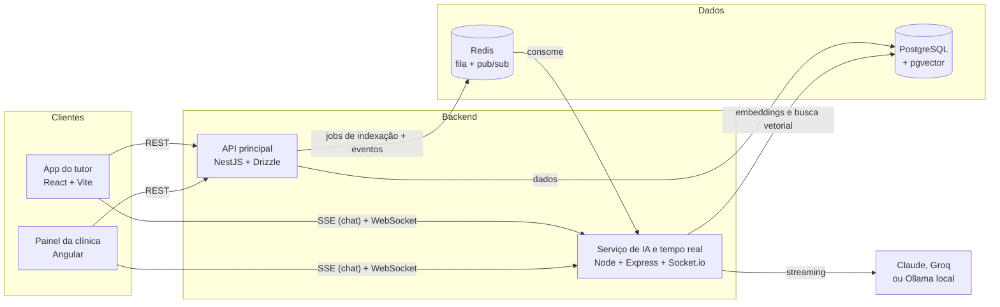

| Parte | Tecnologia | Papel |
| --- | --- | --- |
| `apps/web` | React 19, Vite, React Router | App do tutor: pets, carteira de vacinação, agendamento, assistente |
| `apps/admin` | Angular 22 (signals, standalone) | Painel da clínica: agenda ao vivo, prontuário, pendências, resumo por IA |
| `apps/api` | NestJS 12, Drizzle ORM, JWT | Autenticação, regras de negócio, agenda, prontuário |
| `apps/ai-service` | Node, Express, Socket.io, BullMQ | RAG, streaming das respostas, WebSocket, lembretes |
| Infra | PostgreSQL 17 + pgvector, Redis, Docker | Persistência, busca vetorial, filas e eventos |

## Como a assistente funciona

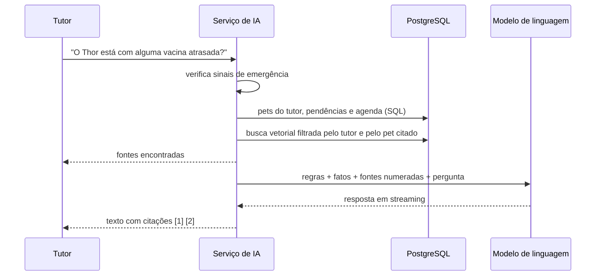

1. **Indexação.** Quando um registro muda, a API enfileira um job. O serviço de IA transforma a linha do banco num texto autocontido em português (*"Vacina de Thor em 10/03/2026: V10. Próxima data prevista: 10/03/2027."*), gera o embedding e faz upsert em `knowledge_chunks`. Na primeira inicialização, tudo que já existe é indexado.
2. **Recuperação híbrida.** A busca semântica encontra trechos parecidos com a pergunta. Se a pergunta cita um pet pelo nome, ele ganha uma busca própria para não ser abafado por registros parecidos de outros pets. Listas, datas e contagens (o que a busca vetorial faz mal) vêm de SQL e entram como fatos estruturados.
3. **Geração com citações.** O prompt numera as fontes e exige que a resposta as cite. No app, cada citação vira um link que abre o pet e destaca o registro usado.
4. **Segurança.** Uma checagem determinística detecta sinais de emergência antes do modelo e mostra o telefone da clínica na hora. O prompt proíbe diagnóstico e prescrição.
5. **Resumo pré-atendimento.** No painel, a veterinária gera um resumo do histórico inteiro do paciente com alergias, condições crônicas, pendências e sugestões para a consulta.

## Como os agentes funcionam

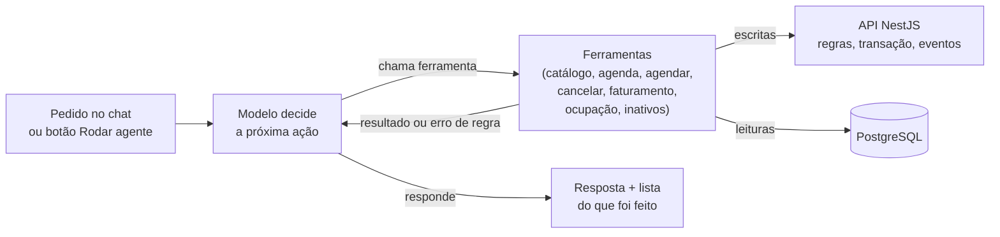

1. **Laço do agente** (`apps/ai-service/src/agent.ts`): o modelo recebe a pergunta, os fatos do sistema e a lista de ferramentas; escolhe uma ferramenta, recebe o resultado e repete até responder. Há um limite de passos, e na última rodada as ferramentas são retiradas para o modelo não entrar em laço.
2. **Escritas passam pela API, com o token do próprio usuário.** O agente agenda e cancela pelos mesmos endpoints do app, então herda as regras de capacidade, a transação serializável, a validação de dono do pet e os eventos em tempo real. Um tutor não consegue agendar para o pet de outra família, peça o que pedir.
3. **Leituras de gestão são consultas fixas e parametrizadas** (`tools/management.ts`): o modelo escolhe a ferramenta e as datas, nunca escreve SQL.
4. **Erros viram informação.** Quando a API recusa ("esse horário acabou de ser preenchido"), o erro volta ao modelo como resultado da ferramenta e ele oferece outra opção.
5. **Degradação graciosa.** Sem chave de modelo ou com o provedor fora do ar, o chat volta a responder no modo RAG e o agente de retenção usa uma mensagem padrão. A tela mostra qual dos dois escreveu cada mensagem.
6. **Funciona com o plano gratuito do Groq** (padrão), com Claude ou com Ollama local: os três provedores implementam a chamada de ferramentas.

## Telas

| App do tutor | Painel da clínica |
| --- | --- |
| 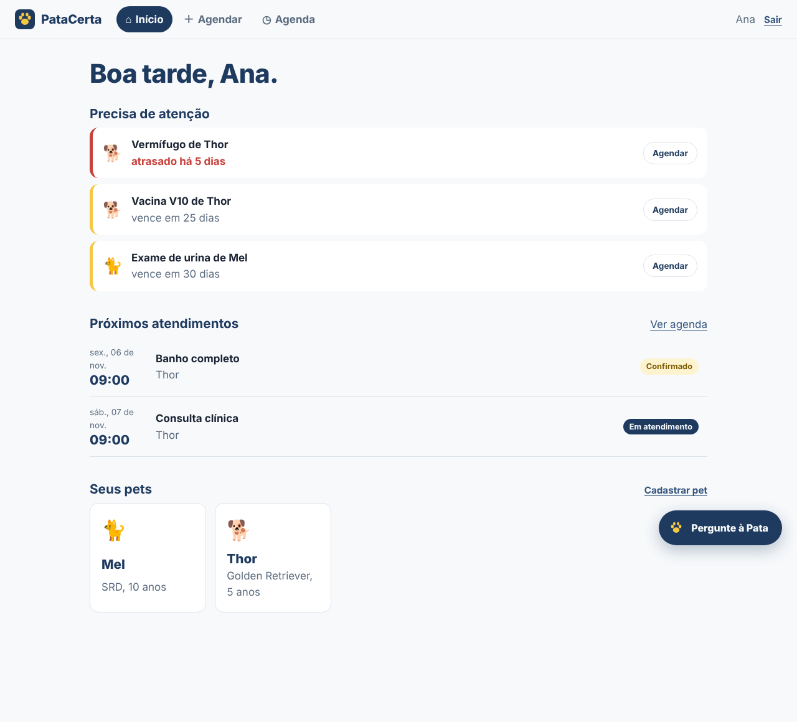 | 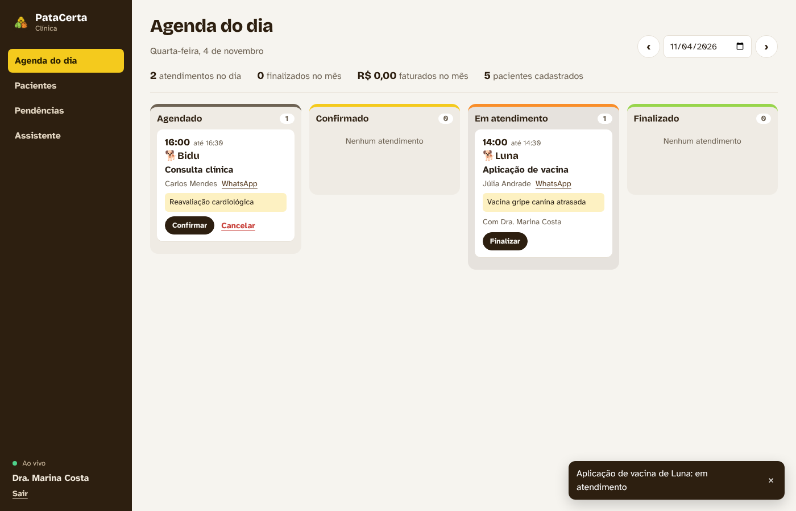 |
| 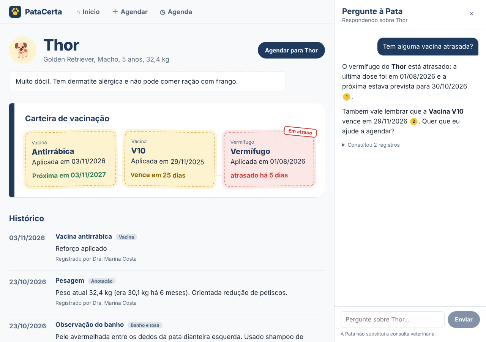 | 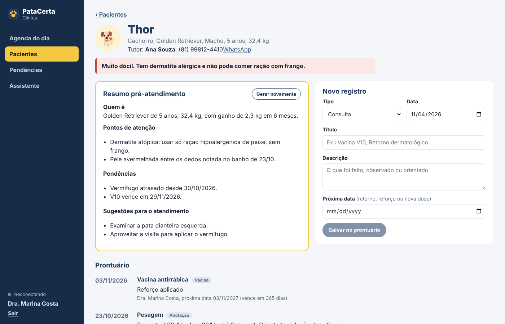 |
| 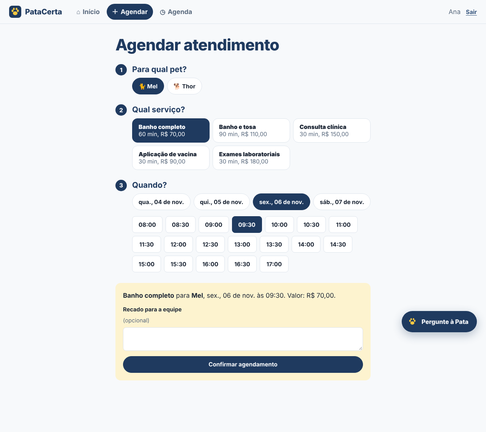 | 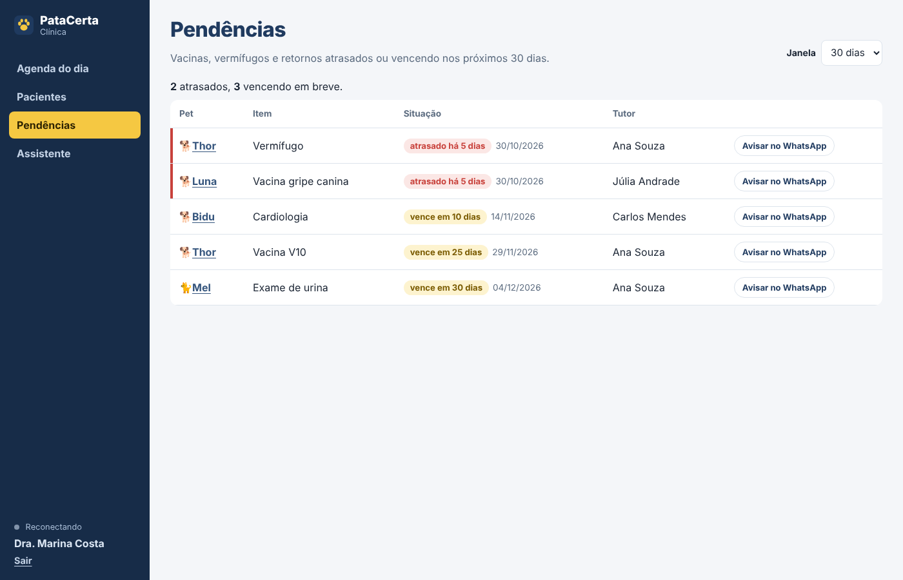 |

## Rodando o projeto

Pré-requisitos: Node 22+ e Docker.

### Tudo com Docker

```bash
cp .env.example .env        # configure o modelo de linguagem (veja abaixo)
docker compose up --build
docker compose exec api node dist/db/seed.js
```

### Desenvolvimento local

```bash
cp .env.example .env
npm run install:all
npm run infra               # sobe PostgreSQL e Redis no Docker
npm run db:setup            # migrações + dados de exemplo
npm run dev                 # sobe os quatro apps juntos
```

| Endereço | O que é |
| --- | --- |
| http://localhost:5173 | App do tutor |
| http://localhost:4200 | Painel da clínica |
| http://localhost:3000/docs | Documentação da API (Swagger) |
| http://localhost:4000/health | Serviço de IA |

### Contas de exemplo

Todas usam a senha `patacerta123`.

| Conta | Papel | Onde entrar |
| --- | --- | --- |
| `ana@patacerta.dev` | Tutora do Thor e da Mel | App do tutor |
| `carlos@patacerta.dev` | Tutor do Bidu | App do tutor |
| `marina@patacerta.dev` | Veterinária | Painel da clínica |
| `admin@patacerta.dev` | Administradora | Painel da clínica |

### Modelo de linguagem

- **Claude (padrão):** defina `ANTHROPIC_API_KEY` no `.env`.
- **Grátis com Groq:** crie uma chave em [console.groq.com](https://console.groq.com) e use `LLM_PROVIDER=openai` com `OPENAI_API_KEY=<sua chave>`. O modelo padrão é o `openai/gpt-oss-120b`. Qualquer outra API compatível com OpenAI (Gemini, OpenRouter) funciona trocando `OPENAI_BASE_URL` e `OPENAI_MODEL`.
- **Totalmente local:** `docker compose --profile local-llm up -d ollama`, depois `docker compose exec ollama ollama pull qwen2.5:7b` e `LLM_PROVIDER=ollama` no `.env`.

## Testes

```bash
npm test
```

- **API:** cálculo de horários disponíveis (capacidade, horários passados, fuso) e a regra de pendências que considera só a dose mais recente.
- **Serviço de IA:** isolamento de dados na busca, montagem dos documentos, seleção de trechos, citações, histórico da conversa, detecção de emergência, embeddings e o laço do agente (erro de regra devolvido ao modelo, parâmetros inválidos, ferramenta inexistente e proteção contra laço).
- **Painel:** renderização das respostas com citações e utilitários de formatação.

O CI no GitHub Actions roda typecheck, testes e build de cada app.

## Decisões e trade-offs

- **Drizzle em vez de Prisma:** schema e migrações em TypeScript puro, sem binários nativos, e consultas SQL explícitas onde a performance importa.
- **Serviço de IA separado:** mantém a API leve e permite escalar a parte pesada (embeddings e streaming) de forma independente. O serviço é dono da tabela vetorial; a API só avisa o que mudou.
- **SSE para o chat e WebSocket para eventos:** SSE é simples e ideal para uma resposta em streaming; WebSocket entrega notificações em tempo real nos dois apps.
- **Fatos via SQL junto com RAG:** perguntas como "o que está atrasado?" precisam de respostas exatas, que a busca semântica sozinha não garante.

## Próximos passos

- Novos agentes sobre o mesmo motor: estoque e compras (prever demanda pelos ciclos de cada pet), escala da equipe e preenchimento de horários vazios, e leitura de documentos (foto da carteira de vacinação, notas fiscais).
- Aprovação do dono antes de ações com impacto financeiro (descontos, pedidos de compra).
- Avaliação automática das respostas da assistente com um conjunto de perguntas de referência.
- Upload de exames em PDF com extração de texto para o prontuário.
- Lembretes por WhatsApp usando a API oficial.
- Testes end-to-end com Playwright cobrindo o fluxo de agendamento.
