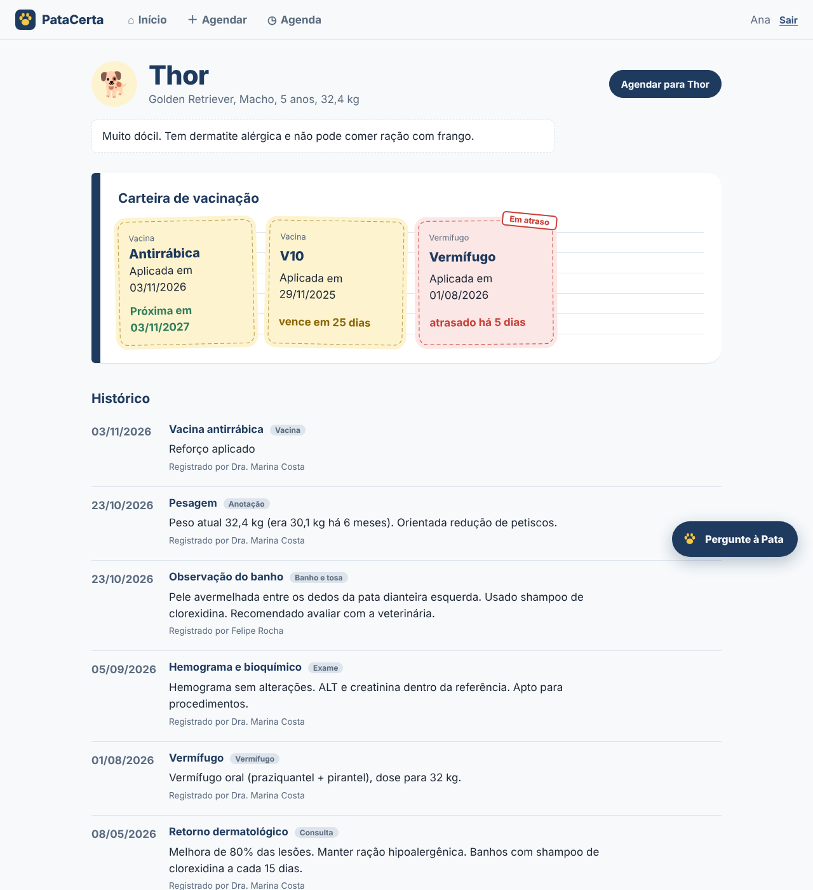
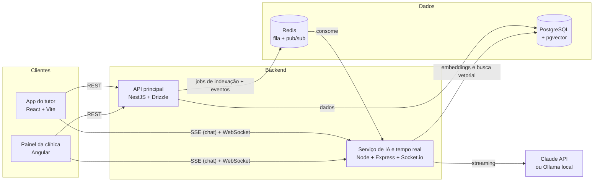
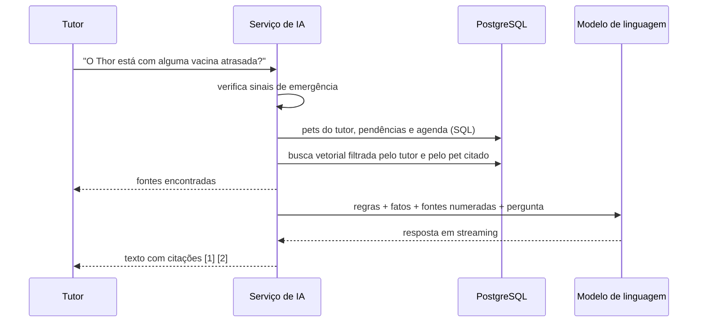
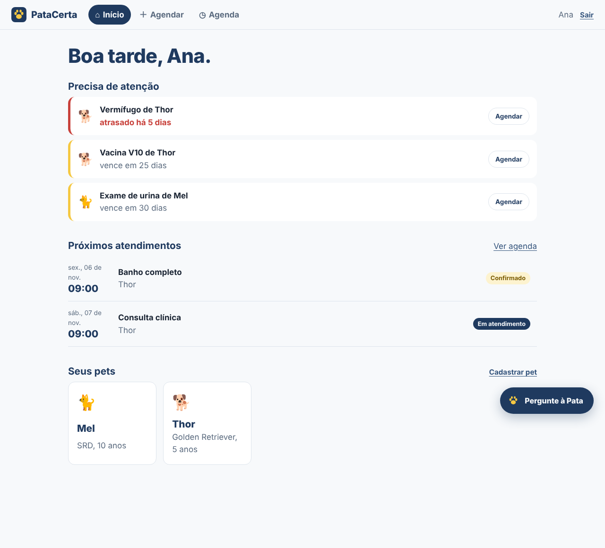
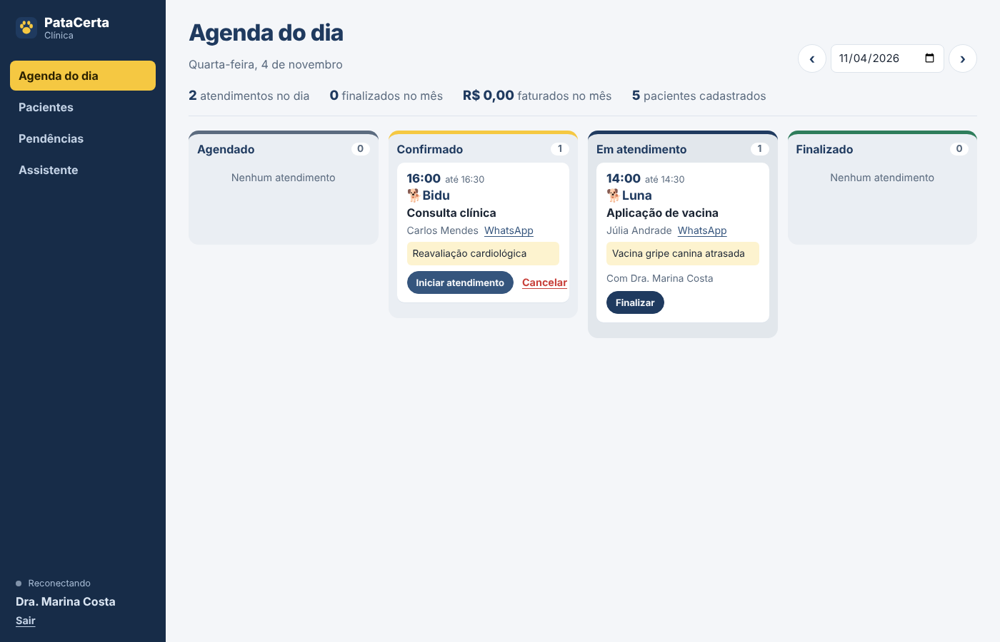
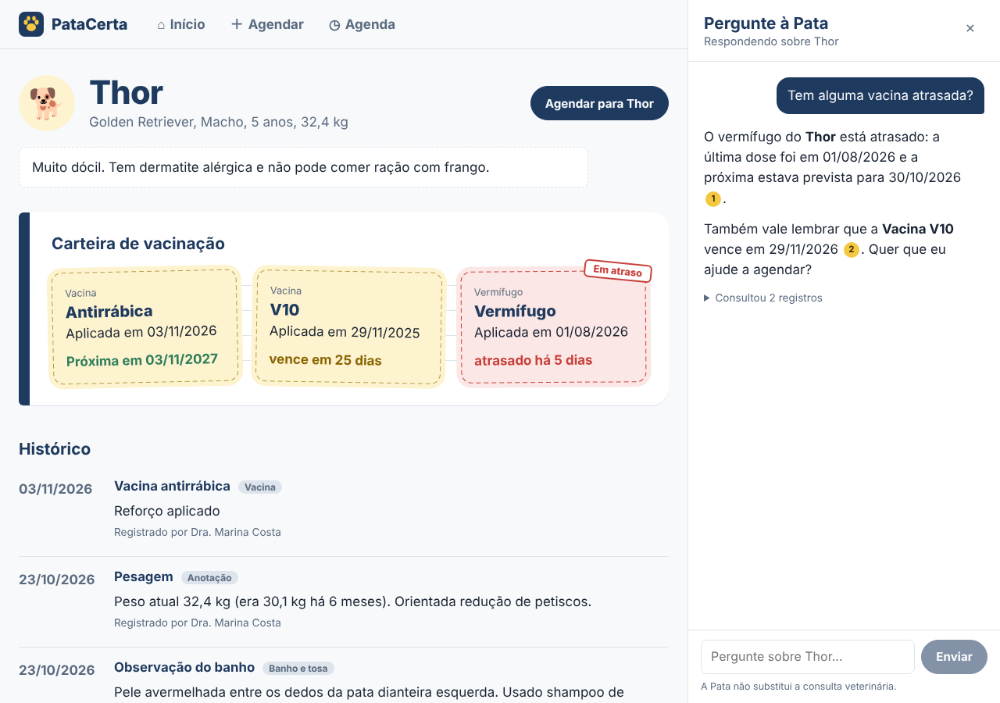
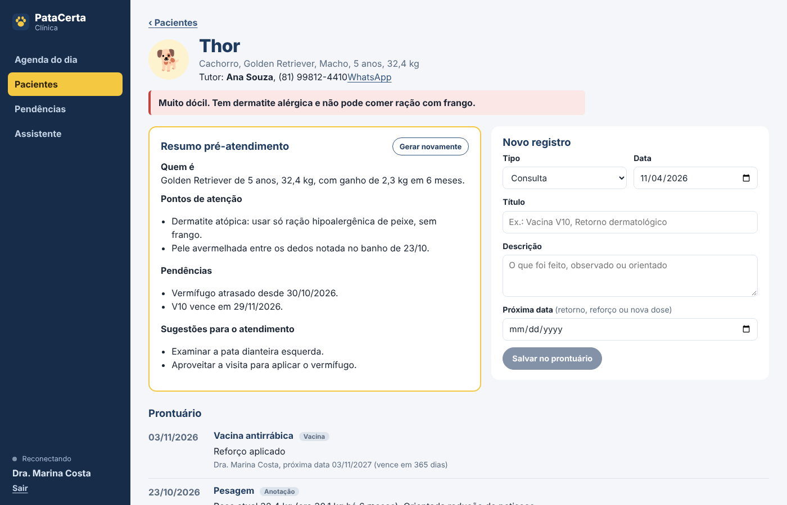
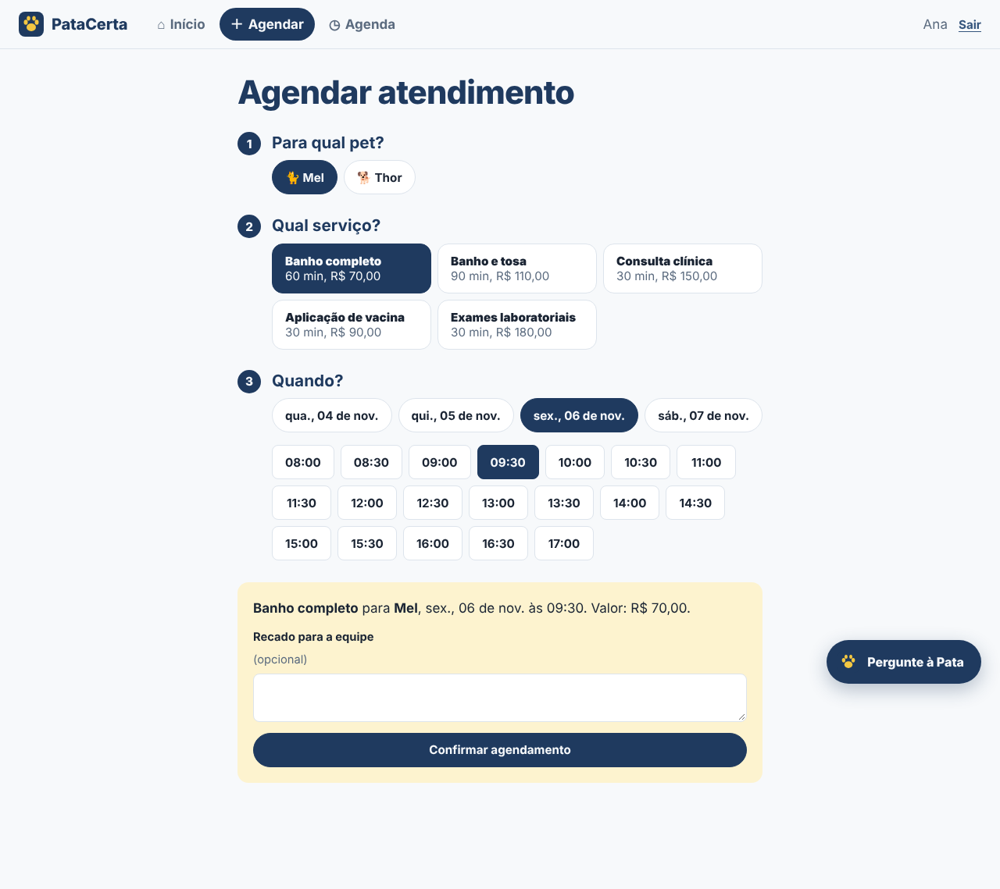
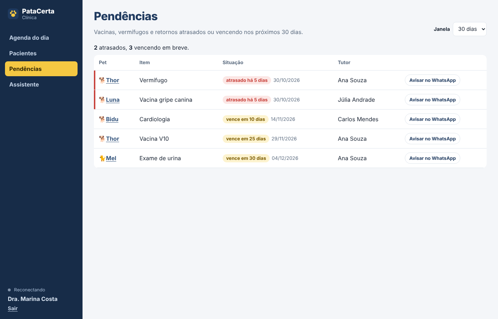

# PataCerta

Sistema de pet shop e clínica veterinária com uma assistente de IA que responde com base no histórico real de cada pet.

O tutor agenda banho, consulta e vacina pelo app, acompanha o atendimento em tempo real e pergunta à assistente coisas como *"quando foi o último vermífugo do Thor?"*. A equipe da clínica gerencia a agenda num quadro ao vivo, registra o prontuário e gera um resumo pré-atendimento de cada paciente com um clique.



## O que tem de interessante aqui

- **IA contextualizada com os dados do sistema (RAG).** Cada consulta, vacina, banho e agendamento vira um trecho indexado com embeddings numa base vetorial (pgvector). A assistente busca os trechos relevantes, combina com fatos calculados via SQL e responde citando de onde tirou cada informação.
- **Isolamento de dados na busca.** Um tutor nunca recupera registros de outra família, seja qual for a pergunta: o filtro por tutor é aplicado dentro da consulta vetorial e coberto por testes.
- **Embeddings rodando localmente.** O modelo de embeddings (multilíngue, ótimo em português) roda no próprio servidor via ONNX. O modelo de linguagem é plugável: Claude pela API ou um modelo aberto local com Ollama, deixando tudo offline.
- **Arquitetura orientada a eventos.** A API publica mudanças numa fila (BullMQ) para indexação e em Redis pub/sub para notificações. O serviço de IA consome a fila e distribui os eventos por WebSocket, com o adaptador Redis do Socket.io para escalar em várias instâncias.
- **Regras de negócio de verdade.** Capacidade por tipo de serviço, transação serializável contra dupla reserva do último horário, máquina de estados do atendimento e lembretes idempotentes de vacinas.

## Arquitetura



| Parte | Tecnologia | Papel |
| --- | --- | --- |
| `apps/web` | React 19, Vite, React Router | App do tutor: pets, carteira de vacinação, agendamento, assistente |
| `apps/admin` | Angular 22 (signals, standalone) | Painel da clínica: agenda ao vivo, prontuário, pendências, resumo por IA |
| `apps/api` | NestJS 12, Drizzle ORM, JWT | Autenticação, regras de negócio, agenda, prontuário |
| `apps/ai-service` | Node, Express, Socket.io, BullMQ | RAG, streaming das respostas, WebSocket, lembretes |
| Infra | PostgreSQL 17 + pgvector, Redis, Docker | Persistência, busca vetorial, filas e eventos |

## Como a assistente funciona



1. **Indexação.** Quando um registro muda, a API enfileira um job. O serviço de IA transforma a linha do banco num texto autocontido em português (*"Vacina de Thor em 10/03/2026: V10. Próxima data prevista: 10/03/2027."*), gera o embedding e faz upsert em `knowledge_chunks`. Na primeira inicialização, tudo que já existe é indexado.
2. **Recuperação híbrida.** A busca semântica encontra trechos parecidos com a pergunta. Se a pergunta cita um pet pelo nome, ele ganha uma busca própria para não ser abafado por registros parecidos de outros pets. Listas, datas e contagens (o que a busca vetorial faz mal) vêm de SQL e entram como fatos estruturados.
3. **Geração com citações.** O prompt numera as fontes e exige que a resposta as cite. No app, cada citação vira um link que abre o pet e destaca o registro usado.
4. **Segurança.** Uma checagem determinística detecta sinais de emergência antes do modelo e mostra o telefone da clínica na hora. O prompt proíbe diagnóstico e prescrição.
5. **Resumo pré-atendimento.** No painel, a veterinária gera um resumo do histórico inteiro do paciente com alergias, condições crônicas, pendências e sugestões para a consulta.

## Telas

| App do tutor | Painel da clínica |
| --- | --- |
|  |  |
|  |  |
|  |  |

## Rodando o projeto

Pré-requisitos: Node 22+ e Docker.

### Tudo com Docker

```bash
cp .env.example .env        # coloque sua ANTHROPIC_API_KEY ou use LLM_PROVIDER=ollama
docker compose up --build
docker compose exec api node dist/db/seed.js
```

### Desenvolvimento local

```bash
cp .env.example .env
npm run install:all
npm run infra               # sobe PostgreSQL e Redis no Docker
npm run db:setup            # migrações + dados de exemplo
npm run dev                 # sobe os quatro apps juntos
```

| Endereço | O que é |
| --- | --- |
| http://localhost:5173 | App do tutor |
| http://localhost:4200 | Painel da clínica |
| http://localhost:3000/docs | Documentação da API (Swagger) |
| http://localhost:4000/health | Serviço de IA |

### Contas de exemplo

Todas usam a senha `patacerta123`.

| Conta | Papel | Onde entrar |
| --- | --- | --- |
| `ana@patacerta.dev` | Tutora do Thor e da Mel | App do tutor |
| `carlos@patacerta.dev` | Tutor do Bidu | App do tutor |
| `marina@patacerta.dev` | Veterinária | Painel da clínica |
| `admin@patacerta.dev` | Administradora | Painel da clínica |

### Modelo de linguagem

- **Claude (padrão):** defina `ANTHROPIC_API_KEY` no `.env`.
- **Totalmente local:** `docker compose --profile local-llm up -d ollama`, depois `docker compose exec ollama ollama pull qwen2.5:7b` e `LLM_PROVIDER=ollama` no `.env`.

## Testes

```bash
npm test
```

- **API:** cálculo de horários disponíveis (capacidade, horários passados, fuso) e a regra de pendências que considera só a dose mais recente.
- **Serviço de IA:** isolamento de dados na busca, montagem dos documentos, seleção de trechos, citações, histórico da conversa, detecção de emergência e embeddings.
- **Painel:** renderização das respostas com citações e utilitários de formatação.

O CI no GitHub Actions roda typecheck, testes e build de cada app.

## Decisões e trade-offs

- **Drizzle em vez de Prisma:** schema e migrações em TypeScript puro, sem binários nativos, e consultas SQL explícitas onde a performance importa.
- **Serviço de IA separado:** mantém a API leve e permite escalar a parte pesada (embeddings e streaming) de forma independente. O serviço é dono da tabela vetorial; a API só avisa o que mudou.
- **SSE para o chat e WebSocket para eventos:** SSE é simples e ideal para uma resposta em streaming; WebSocket entrega notificações em tempo real nos dois apps.
- **Fatos via SQL junto com RAG:** perguntas como "o que está atrasado?" precisam de respostas exatas, que a busca semântica sozinha não garante.

## Próximos passos

- Avaliação automática das respostas da assistente com um conjunto de perguntas de referência.
- Upload de exames em PDF com extração de texto para o prontuário.
- Lembretes por WhatsApp usando a API oficial.
- Testes end-to-end com Playwright cobrindo o fluxo de agendamento.
