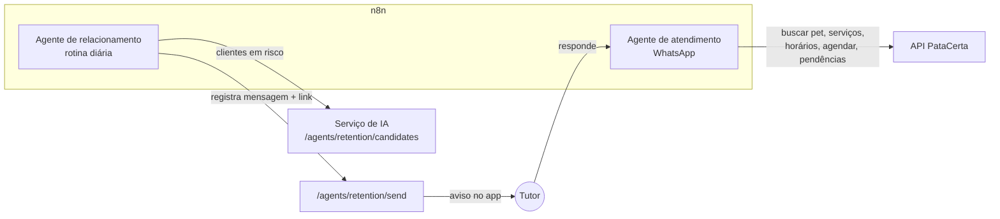
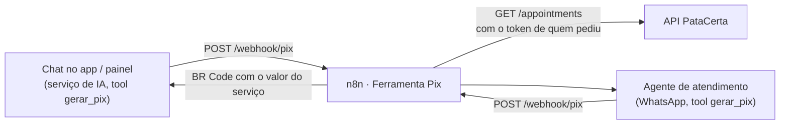

# Agentes no n8n

Os agentes de relacionamento da PataCerta rodam como fluxos visuais no [n8n](https://n8n.io). O n8n orquestra os agentes (modelo, memória, ferramentas) e a PataCerta continua sendo a fonte da verdade: os agentes leem e agem **pela API**, com as mesmas regras do app (capacidade, conflitos, permissões).



| Fluxo | Gatilho | O que o agente faz |
| --- | --- | --- |
| **Agente de relacionamento (rotina diária)** | Todo dia às 9h, ou o botão *Rodar agora* | Busca os pets com cuidados atrasados sem nada agendado e os clientes que sumiram; o **Agente redator** escreve uma mensagem por cliente a partir do histórico, propondo resolver tudo na mesma visita; a PataCerta registra, avisa o tutor no app e devolve o texto do WhatsApp com o link que abre o chat da Pata |
| **Agente de atendimento (WhatsApp)** | Mensagem do tutor (chat do n8n, simulando o WhatsApp) | O **Agente atendente** identifica o pet, consulta serviços e horários, agenda pela API e, antes de confirmar, oferece incluir as pendências do pet na mesma visita (upsell). Se o tutor pedir para pagar, chama a ferramenta `gerar_pix` e envia o Pix copia e cola |
| **Ferramenta Pix** | Webhook `POST /webhook/pix` | Monta o Pix do agendamento; usada pelo WhatsApp e pelo chat do app |

### Ferramenta Pix

O fluxo **Ferramenta Pix** (`ferramenta-pix.json`) é a ferramenta que gera o Pix copia e cola de um agendamento. Ele é chamado pelos dois canais:



- O modelo só informa o `agendamento_id`. O fluxo busca o agendamento **na API com o token de quem pediu** (o tutor só consegue cobrar os próprios agendamentos) e usa o preço do serviço; o valor nunca vem do modelo.
- No app, o código **não passa pelo modelo**: o serviço de IA o entrega à tela (card com botão *Copiar código Pix*). No WhatsApp, o agente envia o `pix_copia_e_cola` na conversa.
- É um Pix **estático** (BR Code com a chave da clínica): não há confirmação automática de pagamento. Para cobrança dinâmica com baixa automática, troque o nó *Montar Pix* por uma chamada ao seu PSP (Mercado Pago, Asaas...) mantendo a mesma resposta.

Configure no `.env` da raiz: `PIX_KEY` (CPF/CNPJ, e-mail, telefone ou chave aleatória), `PIX_RECEIVER_NAME` e `PIX_CITY`. Depois de importar, **ative** o fluxo (a URL `/webhook/pix` só existe com ele ativo):

```bash
docker compose exec n8n n8n update:workflow --id=PcPix --active=true
docker compose restart n8n
```

Teste do código do BR Code (sem subir nada): `node --test n8n/pix.test.mjs`.

## Como rodar

1. Suba a PataCerta (`npm run infra`, `npm run db:setup`, `npm run dev`) e o n8n:
   ```bash
   docker compose up -d n8n
   docker compose exec n8n n8n import:workflow --separate --input=/workflows
   ```
2. Abra http://localhost:5678 e crie a conta local do n8n (só na primeira vez).
3. Em **Credentials**, crie uma credencial **Groq** com a sua chave (grátis em [console.groq.com](https://console.groq.com)) e selecione-a no nó **Modelo Groq** de cada fluxo.
4. **Relacionamento:** abra o fluxo e clique em *Execute workflow*. O último nó lista as mensagens com o link `abrir_no_whatsapp`.
5. **Atendimento:** abra o fluxo e clique em *Open chat*. Exemplo: "Oi, é a Ana, tutora do Thor. Pode ser no próximo sábado de manhã?".

## Configuração

O `docker-compose.yml` passa ao n8n onde está a PataCerta e com qual conta da clínica os agentes agem:

| Variável | Padrão |
| --- | --- |
| `PATACERTA_API_URL` | `http://host.docker.internal:3000/api` |
| `PATACERTA_AI_URL` | `http://host.docker.internal:4000` |
| `PATACERTA_AGENT_EMAIL` / `PATACERTA_AGENT_PASSWORD` | conta de demonstração do seed (troque em produção) |
| `PIX_KEY` / `PIX_RECEIVER_NAME` / `PIX_CITY` | chave Pix e dados do recebedor (sem chave, a ferramenta recusa) |
| `PIX_WEBHOOK_URL` | `http://localhost:5678/webhook/pix` (como o próprio n8n chama a ferramenta) |

O serviço de IA usa `N8N_PIX_URL` (padrão `http://localhost:5678/webhook/pix`; no Compose, `http://n8n:5678/webhook/pix`).

## Próximos passos

- Trocar o gatilho de chat pelo WhatsApp de verdade (nó da Evolution API ou API oficial do WhatsApp) e enviar a mensagem da rotina diária automaticamente.
- Novos agentes como novos fluxos: estoque e compras, escala da equipe, leitura de documentos.
